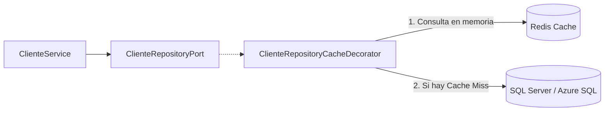
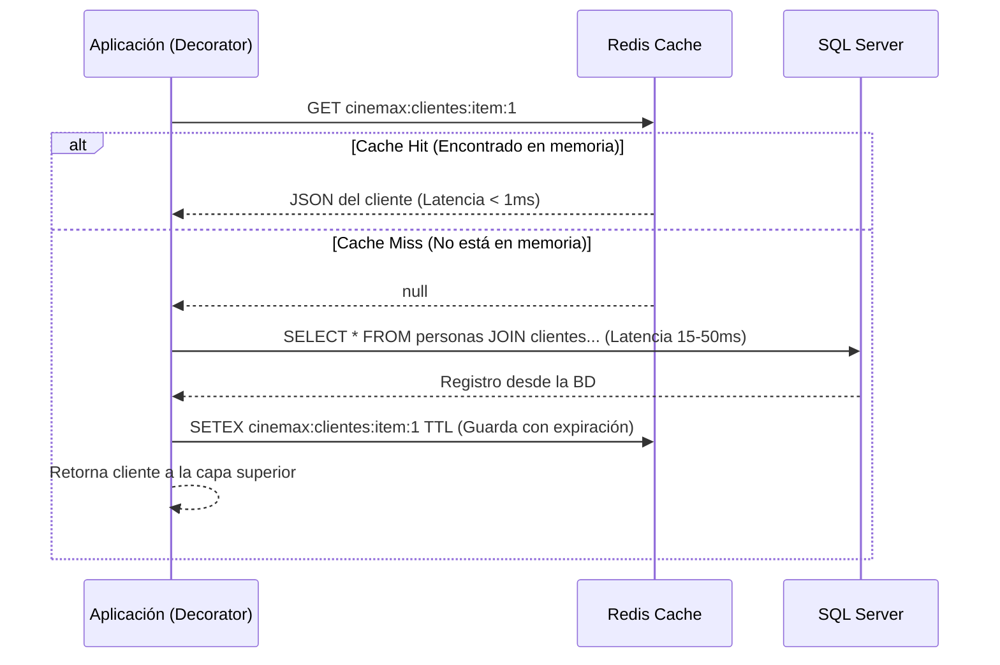

# Guía Profesional de Implementación de Redis Cache
## Proyecto Integrador: CineMax CESDE

Esta documentación recopila las mejores prácticas, patrones de diseño, casos de uso y estrategias para la integración profesional de **Redis Cache** en sistemas con **Arquitectura Hexagonal (Puertos y Adaptadores)**.

---

## 1. Arquitectura Hexagonal y el Patrón Decorador

En una arquitectura limpia, **ni el Dominio ni los Servicios de aplicación deben acoplarse a Redis**. Redis es un detalle de **Infraestructura**.

La forma estándar y profesional de incorporarlo es mediante el **Patrón Decorador (Decorator Pattern)** sobre el Puerto de Salida del Repositorio (`*RepositoryPort`):



### Ventajas del Patrón Decorador:
1. **Transparencia total:** El servicio sigue dependiendo únicamente de la interfaz `ClienteRepositoryPort`.
2. **Desacoplamiento:** Si Redis se apaga, falla o se sustituye, el sistema puede degradar con gracia (*fallback*) directamente a la base de datos sin romper la lógica del negocio.
3. **Principio de Responsabilidad Única (SRP):** El repositorio de base de datos solo sabe de SQL, y el decorador solo sabe de caching y políticas de expiración.

---

## 2. Estrategia de Lectura: Cache-Aside (Lazy Loading)

Es el patrón más eficiente para sistemas donde el volumen de lecturas supera ampliamente al de escrituras (como carteleras, funciones y datos de clientes).



---

## 3. Sincronización y Actualizaciones: ¿Cómo evitar datos obsoletos?

Cuando ocurre un `INSERT`, `UPDATE` o `DELETE`, la memoria y el almacenamiento persistente corren el riesgo de desincronizarse.

### Invalidación (*Cache Invalidation / Delete*) vs Reescritura (*Write-Update*)

| Estrategia | Descripción | Recomendación |
| :--- | :--- | :--- |
| **Reescritura (*Write-Update*)** | Guardar en SQL y acto seguido sobrescribir el JSON en Redis. | ⚠️ **No recomendada:** En entornos concurrentes con múltiples hilos o instancias, dos escrituras casi simultáneas pueden guardarse en orden inverso en Redis, corrompiendo la caché. |
| **Invalidación (*Delete on Write*)** | Guardar en SQL y **eliminar inmediatamente la llave en Redis (`DEL`)**. |  **Estándar Profesional:** La siguiente lectura sufrirá un *Cache Miss* controlado, viajará a la base de datos por el dato recién guardado y lo volverá a poblar en Redis. |

### El Reto de las Listas (`getAll` vs `getById`)
* Un registro individual vive en: `cinemax:clientes:item:{id}`
* La lista completa vive en: `cinemax:clientes:all`

> [!IMPORTANT]
> **Regla de oro de colecciones:** Siempre que se registre, actualice o elimine un cliente individual, **debes invalidar tanto la llave individual como la llave de la lista completa (`cinemax:clientes:all`)**, ya que la lista anterior ha quedado desactualizada.

---

## 4. Los 4 Grandes Desafíos en Producción y sus Soluciones

### A. Avalancha de Caché (*Cache Avalanche*)
* **Escenario:** Se configuran todas las llaves de películas con un TTL fijo de 30 minutos. Al cumplirse la media hora, miles de llaves expiran exactamente en el mismo segundo. Todas las peticiones van directamente a SQL Server, saturando el servidor.
* **Solución (TTL con Jitter):** Aplicar una variación aleatoria (*jitter*) al tiempo de expiración:
  $$\text{TTL Final} = \text{TTL Base (ej: 1800 seg)} + \text{Aleatorio}(0 \text{ a } 120 \text{ seg})$$
  Esto distribuye la expiración de forma escalonada en el tiempo.

### B. Estampida de Caché (*Cache Stampede / Thundering Herd*)
* **Escenario:** Una llave con altísimo tráfico (ej. `cinemax:funciones:cartelera`) expira. En ese milisegundo llegan cientos de peticiones simultáneas; al no encontrarla en Redis, todas disparan la misma consulta pesada contra la base de datos a la vez.
* **Solución (Mutex Lock Distribuido):** Utilizar una operación atómica `SET NX PX` en Redis:
  * Solo el primer hilo que sufrió el *miss* adquiere el candado y consulta la base de datos.
  * Los demás hilos esperan brevemente (50-100 ms) y vuelven a consultar Redis, encontrando el dato ya listo.

### C. Penetración de Caché (*Cache Penetration*)
* **Escenario:** Un cliente malicioso o un error en la interfaz consulta IDs que no existen (ej: `id = -1` o `id = 9999999`). Como no existen ni en Redis ni en SQL Server, **nunca entran a la caché**, haciendo que cada petición golpee la base de datos física.
* **Solución:** Almacenar en Redis un valor centinela (`"NULL"` o `"{}"`) con un TTL corto (ej. 1 a 2 minutos). Si vuelven a consultar el ID falso, Redis responde de inmediato indicando que no existe.

### D. Convención de Nombres de Llaves (*Namespacing*)
En entornos empresariales es indispensable usar prefijos claros estructurados por dos puntos (`:`):

```text
cinemax:clientes:item:{id}          --> Cliente específico
cinemax:clientes:all                --> Listado general de clientes
cinemax:peliculas:item:{id}         --> Película individual
cinemax:peliculas:cartelera         --> Funciones y películas activas
```

---

## 5. Arquitectura del Código de Referencia

A nivel de implementación con Java y la librería **Jedis**:

```java
public class ClienteRepositoryCacheDecorator implements ClienteRepositoryPort {

    private final ClienteRepositoryPort dbRepository; // ClienteRepositoryImpDB
    private final JedisPool jedisPool;
    private static final int TTL_BASE_SEGUNDOS = 600; // 10 minutos

    public ClienteRepositoryCacheDecorator(ClienteRepositoryPort dbRepository, JedisPool jedisPool) {
        this.dbRepository = dbRepository;
        this.jedisPool = jedisPool;
    }

    @Override
    public Cliente getById(int id) {
        String key = "cinemax:clientes:item:" + id;

        try (Jedis jedis = jedisPool.getResource()) {
            // 1. Intentar leer de Redis (Cache Hit)
            String json = jedis.get(key);
            if (json != null) {
                return JsonHelper.fromJson(json, Cliente.class);
            }

            // 2. Cache Miss: Consultar la Base de Datos SQL Server
            Cliente cliente = dbRepository.getById(id);

            // 3. Si existe, guardar en Redis con TTL + Jitter
            if (cliente != null) {
                int ttlJitter = TTL_BASE_SEGUNDOS + (int) (Math.random() * 60);
                jedis.setex(key, ttlJitter, JsonHelper.toJson(cliente));
            } else {
                // Protección contra Cache Penetration
                jedis.setex(key, 60, "NULL");
            }
            return cliente;
        } catch (Exception e) {
            // Fallback: Si Redis se cae, no bloqueamos la app; consultamos la BD
            return dbRepository.getById(id);
        }
    }

    @Override
    public Cliente update(int id, Cliente cliente) {
        // 1. Actualizar primero en la base de datos confiable
        Cliente actualizado = dbRepository.update(id, cliente);

        // 2. Invalidar llaves en Redis
        try (Jedis jedis = jedisPool.getResource()) {
            jedis.del("cinemax:clientes:item:" + id);
            jedis.del("cinemax:clientes:all");
        } catch (Exception e) {
            // Log de advertencia
        }

        return actualizado;
    }
}
```

---

## 6. Resumen de Decisiones de Diseño

1. **Patrón:** Decorador sobre el Puerto del Repositorio.
2. **Lectura:** *Cache-Aside* con serialización JSON (Jackson).
3. **Escritura:** Invalidación de llaves individuales y colecciones (`DEL`).
4. **Resiliencia:** Bloque `try-catch` con *Fallback* directo a base de datos si Redis no responde.
5. **Estabilidad:** TTL con variación aleatoria (*Jitter*) y almacenamiento de valores nulos con expiración corta.
